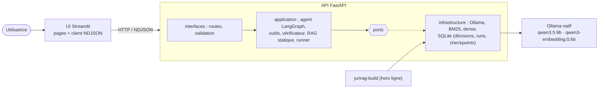
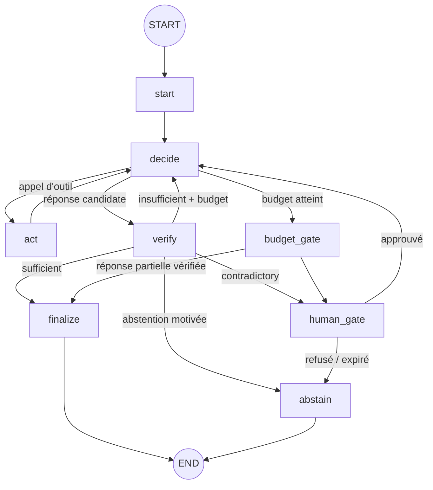
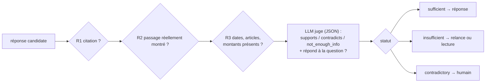

# Construire un Agentic RAG sur la jurisprudence

**Rapport technique · octobre 2026**

Application *JuriRAG* : lancement décrit dans `README.md`. Tous les chiffres de ce rapport proviennent des fichiers de `docs/results/` et des traces de `docs/traces/`, produits par les commandes indiquées. Aucun résultat n'a été estimé ni reconstitué.

---

## 1. Résumé

Le système répond à des questions de jurisprudence à partir d'un corpus local de **3 954 décisions de la Cour de cassation** (2022–2024). Un agent LangGraph y **décide** à chaque étape s'il faut rechercher (`search_cases`), lire une décision (`read_case`) ou répondre. Toute réponse candidate passe par un **vérificateur de preuves**, qui combine des règles déterministes et un LLM juge. Selon son verdict, l'agent rend la réponse, relance la recherche, demande une validation humaine ou s'abstient. Chaque étape est diffusée en direct dans l'interface. Quatre extensions sont implémentées : mémoire, multi-agents, human-in-the-loop, observabilité. Tous les modèles tournent localement avec Ollama : qwen3.5:9b pour la génération, qwen3-embedding:0.6b pour les embeddings.

Résultats principaux, tous mesurés :

- **Recherche** : la recherche hybride BM25 + dense (RRF) obtient MRR@10 = 0,860 sur des questions reformulées, contre 0,837 pour BM25 et 0,840 pour le dense (index principal).
- **Choix du modèle** : avec le raisonnement activé pour les décisions, qwen3.5:9b prend 12 décisions correctes sur 12 au banc d'essai ; sans raisonnement, qwen3.5:9b comme qwen3:8b n'en prennent que 9.
- **Scénarios de test** :
  - le scénario multi-étapes aboutit à une réponse vérifiée citant trois zones de l'arrêt ;
  - la question hors corpus aboutit à une abstention motivée après cinq reformulations ;
  - le vérificateur a intercepté une **erreur juridique réelle**, une réponse contredite par le passage cité.
- **Comparaison** sur 8 questions × 3 modes (§16) :
  - le nombre de réponses entièrement vérifiées est égal (3/8 dans chaque mode) ;
  - mais le RAG statique affiche 7 affirmations non établies, contre 0 pour les agents ;
  - pour un coût en appels LLM multiplié par 2,9 (agent unique) ou 6,8 (multi-agents).

## 2. Objectifs et périmètre

L'objectif est de transformer un RAG classique en système agentique :

- réutiliser le retrieval comme outil ;
- boucler avec un routage conditionnel ;
- vérifier avant de répondre ;
- rendre l'exécution observable.

Le socle RAG (recherche, lecture, résumé, question-réponse) a été construit d'abord, en reprenant l'architecture d'une application précédente (client Ollama, API FastAPI, interface Streamlit). L'analyse complète du besoin (exigences, ambiguïtés, risques) se trouve dans `docs/ANALYSE.md` ; les décisions, au format DEC-XXX, dans `docs/DECISIONS.md`.

## 3. Le corpus

**Source** : `antoinejeannot/jurisprudence` sur Hugging Face, révision figée `8019db1…` (v2025.03.20), licence Etalab 2.0, téléchargée et vérifiée le 23 octobre 2026. Les trois fichiers parquet totalisent 1 058 823 décisions.

**Périmètre retenu** (DEC-004) :

- split `cour_de_cassation`, années 2022 à 2024 ;
- six chambres : sociale, trois chambres civiles, commerciale, criminelle ;
- exclusion des décisions de procédure sans motivation au fond : ordonnances, déchéances, désistements ;
- échantillon de 4 000 décisions (graine 42), dont la moitié publiées au Bulletin ;
- 46 doublons d'identifiant écartés, soit **3 954 décisions** et **27 249 passages**.

**Particularités vérifiées dans les données**, et non supposées :

- le champ `zones` découpe chaque arrêt en introduction, exposé, moyens, motivations et dispositif ;
- il est présent sur environ 99 % des décisions depuis 2016, absent sur les plus anciennes ;
- ses offsets de fin dépassent parfois d'un caractère la longueur du texte, d'où un bornage ;
- les visas contiennent du HTML, qui est retiré ;
- certains textes contiennent les séparateurs Unicode U+2028 et U+2029, ce qui a causé un bug (§18).

**Reproductibilité** : `make index` reconstruit l'index à l'identique. Le manifeste `data/index/main/manifest.json` consigne la révision, les filtres, les rejets et les durées. Le débit d'embedding mesuré est de 8,4 passages par seconde, ce qui explique la taille retenue (DEC-006).

## 4. Le socle RAG

| Étape | Choix |
|---|---|
| Découpage | Structurel par zone, puis fenêtres de phrases d'environ 450 tokens avec 15 % de chevauchement. Annexes exclues : elles répètent les moyens des parties. |
| Lexical | BM25 (bm25s), stopwords et racinisation français ; les numéros « 2312-18 » restent un seul token |
| Dense | qwen3-embedding:0.6b (dimension 1 024), recherche exacte |
| Fusion | Reciprocal Rank Fusion, k = 60 |
| Génération | Prompt à passages délimités `<doc id="Pn">`, une citation par phrase, « les passages ne permettent pas de répondre » si nécessaire |
| Résumé | Faits (exposé), procédure (introduction et exposé), décision (motivations et dispositif) ; « non indiqué » si une zone manque |

### Évaluation du retrieval

Aucun jeu annoté n'existe pour ce corpus. J'ai construit des pseudo-requêtes à partir de 150 arrêts publiés, sur **l'index principal** de 3 954 décisions (DEC-008), sous trois formes : le début du **sommaire**, les **thèmes** du titrage, et une **question** reformulée par le modèle local avec la consigne de ne pas recopier les termes du sommaire. La réponse attendue est la décision source.

| Méthode | Sommaire MRR@10 | Thèmes MRR@10 | Question MRR@10 | Question Hit@5 |
|---|---|---|---|---|
| BM25 | **0,904** | 0,477 | 0,837 | 0,933 |
| Dense | 0,672 | 0,491 | 0,840 | 0,940 |
| **Hybride (retenu)** | 0,797 | **0,509** | **0,860** | **0,953** |

*Tableau 1 — Retrieval au niveau des décisions sur l'index principal (`docs/results/retrieval_main.md`). Le choix a d'abord été fait sur l'index de développement (1 496 décisions, `retrieval_dev.md`), avec le même classement : questions, hybride 0,911 contre 0,878 en BM25 et 0,856 en dense. L'écart se réduit quand le corpus grandit.*

Ce tableau montre que BM25 ne gagne que sur les requêtes qui recopient la motivation, ce qui est un biais lexical attendu. Sur les mots-clés et sur les questions en langage courant, l'hybride l'emporte : les deux familles se trompent différemment. Limites de cette évaluation :

- une seule décision est comptée comme pertinente par requête ;
- les questions sont générées par le modèle même du système ;
- seul le classement relatif des méthodes est interprétable.

## 5. Principes de conception appliqués

| Notion | Usage dans le projet |
|---|---|
| Workflow ou agent ; « commencer simple, mesurer » | Le RAG statique est gardé comme base de comparaison ; l'autonomie n'est ajoutée que là où elle se mesure |
| Boucle observer → raisonner → agir, conditions d'arrêt | Nœuds `decide`, `act`, `verify` ; arrêt sur réponse, budget, erreur, humain |
| Function calling : le LLM demande, le code exécute | Schémas JSON des outils, validation pydantic, liste blanche |
| Concevoir de bons outils | Deux outils de haut niveau, observations concises, erreurs explicites |
| Moindre privilège, contenu non fiable | Aucune exécution libre ; passages traités comme des données |
| Garder le contrôle d'une boucle | Budget d'itérations, validation humaine, traces, sorties structurées, vérification externe |
| Context engineering, élagage | Observations anciennes élaguées, l'état est tenu par le code (harness) |
| Grounding, contexte suffisant, conflits | Vérificateur par affirmation ; statuts `insufficient` et `contradictory` |
| Corrective RAG, multi-hop | Relance après échec du contrôle ; lecture d'une affaire trouvée |
| Évaluer retrieval et génération séparément | Hit@k et MRR d'un côté ; fidélité et pertinence de l'autre |
| Mémoire de court terme, checkpointer | Mémoire de session par `thread_id` |
| Multi-agents : superviseur, échecs, grille de décision | Mode `multi`, comparé à l'agent unique |
| Humain dans la boucle | `interrupt()` et reprise |
| Température selon la tâche | 0,1 pour décider et rédiger ; 0 pour le juge |

## 6. Architecture

Clean architecture en trois services (DEC-003). Le schéma modifiable est dans `docs/diagrams/01_architecture.mmd`.



*Figure 1 — Architecture. L'UI ne parle qu'à l'API ; la couche application ne dépend que de ports, ce qui permet de tester toute la logique de l'agent avec des doublures (81 tests sans Ollama).*

Pourquoi pas des microservices ? Ils ajouteraient du réseau et des déploiements sans besoin réel. Pourquoi Ollama en natif ? Sous macOS, Docker n'a pas accès au GPU Metal.

## 7. Boucle agentique et outils



*Figure 2 — Graphe à agent unique (`application/agent/graph.py`). Les arêtes sont déclarées explicitement dans `builder()` : ce schéma correspond exactement au code.*

**Outils** (DEC-009) :

- `search_cases(query, k)` regroupe les passages par décision et renvoie les métadonnées avec le meilleur passage ;
- `read_case(case_id, focus?)` renvoie au plus 8 passages, dans l'ordre exposé → motivations → dispositif, ou classés selon le `focus`.

Chaque passage montré reçoit un **alias court `[Pn]`**, stable pendant tout le run. Un modèle de 9B recopie mal les identifiants longs, et c'est le code qui fait la correspondance avec la référence exacte : `passage_id` et offsets. Une citation hors du registre est donc inventée par construction.

**Contrôle de la boucle** (DEC-011) :

- 5 itérations au plus ;
- au plus 2 outils par tour ;
- une requête déjà jouée est refusée sans être exécutée ;
- les observations anciennes sont élaguées.

La trace n'affiche que des justifications opérationnelles produites par le code, jamais le raisonnement interne du modèle.

**Choix du modèle** (DEC-001, DEC-016) : banc de quatre décisions types (chercher, lire, répondre, s'abstenir), répétées trois fois chacune, avec le prompt et les outils de l'application.

| Configuration | Chercher | Lire l'affaire | Répondre | S'abstenir | Total | Latence médiane |
|---|---|---|---|---|---|---|
| qwen3.5:9b, sans raisonnement | 3/3 | 0/3 | 3/3 | 3/3 | 9/12 | 2,4 s |
| qwen3:8b, sans raisonnement | 3/3 | 0/3 | 3/3 | 3/3 | 9/12 | 1,7 s |
| **qwen3.5:9b, raisonnement activé** | 3/3 | **3/3** | 3/3 | 3/3 | **12/12** | 3,4 s |

*Tableau 2 — Banc d'essai (`docs/results/bench_models*.md`). Seul qwen3.5:9b avec raisonnement lit de lui-même l'affaire quand l'extrait ne suffit pas. Sans raisonnement, les deux modèles répondent « l'extrait ne précise pas… », ce qui est honnête mais incomplet.*

Deux leçons de ce banc, documentées dans `docs/results/bench_history/` :

- une consigne de prompt bien intentionnée a fait chuter un score de 3/3 à 0/3 : le modèle s'est mis à répondre sans chercher, avec une citation inventée. La consigne a été retirée ;
- mon détecteur d'abstention produisait de faux échecs. Il a été corrigé.

Le raisonnement est activé pour les seules décisions de l'agent, et désactivé pour le juge et la rédaction. Un garde-fou déterministe (DEC-021) oblige en outre à lire une décision trouvée avant de conclure qu'une information manque.

## 8. Vérification des preuves



*Figure 3 — Vérificateur (`application/agent/verifier.py`, schéma complet dans `docs/diagrams/04_verification.mmd`).*

**Règles déterministes** (R1 à R3), gratuites et reproductibles, appliquées en premier. **LLM juge** en un seul appel, à température 0 et en JSON contraint. Le juge contrôle aussi la **pertinence** de la réponse. Ce contrôle a été ajouté après le premier run réel : la réponse était fidèle aux passages, mais traitait de la mise à pied au lieu de l'abandon de poste, et la fidélité seule ne détecte pas ce cas.

**Le vérificateur peut échouer** : un juge indisponible, un JSON invalide, un verdict manquant ou un champ de pertinence absent ne valident rien. Aucun seuil de similarité ne sert de preuve.

Quand une partie seulement des affirmations est vérifiée et que le budget est épuisé, la réponse rendue est **partielle** : elle ne contient que les affirmations vérifiées, et les autres sont listées comme limites.

Limite assumée : le juge est le même modèle que le rédacteur. Le second appel n'est donc pas une preuve de fiabilité, d'où l'ordre « règles d'abord ».

## 9. API externe

Aucune API externe n'est utilisée (DEC-015) : c'est un choix délibéré. L'API Judilibre (PISTE) aurait étendu le corpus, mais elle demande l'ouverture d'un compte et la transmission des questions à un tiers. Le système distingue néanmoins la provenance de chaque passage (`origin` vaut « corpus ») et l'affiche, ce qui le prépare à une source externe.

## 10. Mémoire et multi-agents

**Mémoire** (DEC-013) :

- elle est stockée par un checkpointer SQLite LangGraph, avec `thread_id` égal à la session ;
- elle conserve l'affaire en cours et les trois derniers échanges, présentés au modèle comme du contexte à ne jamais citer ;
- elle expire après 2 h ;
- elle est purgée au changement d'affaire, et réinitialisable depuis l'interface ;
- elle est distincte de l'index : les preuves repartent de zéro à chaque run.

Tests : conservation de l'affaire, isolation entre sessions, réinitialisation, changement d'affaire.

**Multi-agents** (DEC-014) :

- **superviseur** : un LLM avec sortie JSON, encadré par des garde-fous déterministes : pas de rédaction sur un dossier vide, pas de nouvelle rédaction sans passage nouveau, pas d'arrêt sans recherche préalable ;
- **chercheur** : au plus 3 tours d'outils par délégation, avec un contexte isolé ;
- **vérificateur** : le même composant que l'agent unique ;
- le dossier de preuves et l'historique des requêtes sont partagés, ce qui évite de refaire le même travail.

Le schéma est dans `docs/diagrams/05_multi_agent.mmd`. Le coût de cette architecture est mesuré au §16.

## 11. Human-in-the-loop et observabilité

**Validation humaine** (DEC-015) : faute d'API externe, elle porte sur trois actions internes sensibles. Les recherches locales n'en demandent jamais.

- **Prolonger le budget d'itérations.** Le run est suspendu par `interrupt()` : aucun appel au modèle n'a lieu tant que l'humain n'a pas répondu, ce que vérifient les tests.
- **Diffuser une réponse contredite par ses sources.**
- **Exporter le dossier.** Rien n'est écrit avant la confirmation, et une décision ne peut pas être rejouée.

Expiration : 5 minutes. Une nouvelle question arrivant pendant l'attente clôt la validation en cours comme expirée. Chaque décision est tracée par un événement `HUMAN`.

**Observabilité** (DEC-020) : pour chaque run, on enregistre en SQLite :

- les appels LLM et les tokens réellement renvoyés par Ollama ;
- les appels par outil et le nombre de recherches ;
- les itérations ;
- les latences totale et par étape ;
- le statut du vérificateur, le motif d'arrêt et les erreurs.

Ces métriques sont agrégées par mode (`GET /api/v1/metrics`, page *Observabilité*). Le coût monétaire est affiché comme « non applicable (modèle local) » : aucun chiffre n'est inventé.

## 12. Choix techniques et alternatives rejetées

| Choix | Alternative rejetée | Raison |
|---|---|---|
| LangGraph, graphe explicite | `create_agent` (ReAct prêt à l'emploi) ; boucle Python maison | Le vérificateur et les conditions d'arrêt doivent être visibles ; LangGraph apporte le checkpointer, `interrupt` et le streaming |
| Hybride RRF | BM25 seul (meilleur sur les sommaires) | Moins bon sur les mots-clés et les questions (tableau 1) |
| Recherche dense exacte (numpy) | FAISS ou base vectorielle | 27 249 vecteurs : la force brute répond en quelques millisecondes |
| qwen3.5:9b avec raisonnement pour décider | 27B ou 35B ; raisonnement partout | Mémoire et latence ; le raisonnement n'apporte rien au juge à sortie contrainte |
| Alias `[Pn]` | Citation par `passage_id` | Identifiants longs mal recopiés par un 9B ; vérification d'existence triviale |
| Streamlit | HTML/JS sur mesure | Prototypage rapide en Python, suffisant pour une interface de démonstration |

## 13. Design de l'interface

Direction **« Greffe »**, éditoriale et archive, choisie parmi trois propositions (DEC-019) :

- palette papier `#F4F0E6`, encre `#1C1B19`, sang-de-bœuf `#7A2020`, vert-de-gris `#4F6B5A` pour « vérifié » ;
- typographie Newsreader pour le texte des arrêts, IBM Plex Sans pour l'interface, IBM Plex Mono pour la trace ;
- les résultats prennent la forme d'un index de recueil plutôt que de cartes ;
- les passages apparaissent comme des notes en marge, les citations `[Pn]` sont cliquables et mettent le passage en surbrillance ;
- un tampon indique le statut de vérification, et la trace est tenue comme un registre.

> **Captures d'écran** : non encore réalisées. Elles doivent provenir de l'application réelle, voir `report/figures/README.md`. Elles seront insérées ici, chacune avec sa légende :
> - figure 4 : page *Recherche & lecture* ;
> - figure 5 : page *Agent* pendant un run ;
> - figure 6 : demande de validation humaine ;
> - figure 7 : page *Observabilité*.

## 14. Tests des trois scénarios

Les questions ont été choisies **dans l'index réel** (`docs/results/questions.json`), à partir de requêtes SQL sur les thèmes et les textes. Les traces complètes sont dans `docs/traces/`. Toute validation humaine y a reçu la réponse « refuser », fournie par le script de scénario et signalée comme telle.

| Scénario | Question (abrégée) | Outils | Appels LLM | Vérification | Issue | Latence |
|---|---|---|---|---|---|---|
| **1 — RAG simple** (essai 1) | Délai entre entretien et signature d'une rupture conventionnelle ? | `search` ×1 | 3 | **sufficient** | Réponse vérifiée, une seule recherche | 43 s |
| **1 — RAG simple** (essai 2, même configuration) | idem | `search` ×2, `read` ×1 | 7 | insufficient → partielle | Réponse partielle vérifiée (2 affirmations) | 104 s |
| **2 — Multi-étapes** | Rupture annulée pour dol du salarié : reproche, cour d'appel, effets ? | `search`, `read` | 6 | insufficient → **sufficient** | Réponse vérifiée, 3 passages (motivations, introduction) | 104 s |
| **3a — Formulation profane** | « Mon patron veut m'interdire de travailler chez un concurrent… » | `search` ×1 | 3 | **contradictory** | Validation humaine → refus → abstention | 64 s |
| **3b — Absent du corpus** | Licenciement fondé sur un algorithme d'IA ? | `search` ×5 | 5 | — | Budget → validation humaine → refus → abstention | 70 s |

*Tableau 3 — Scénarios (`docs/results/scenarios.md` ; essai 1 du scénario 1 : `docs/traces/S1_single_essai1.md`, run `1921e064452f`).*

L'essai 1 du scénario 1 est exactement le comportement attendu : une recherche, une réponse vérifiée, aucune étape inutile. L'essai 2, avec la même question et la même configuration deux minutes plus tard, a pris un autre chemin (§18). Un seul run ne suffit donc pas pour juger un agent.

**Scénario 2** (`docs/traces/S2_single.md`) : il montre la boucle telle qu'elle a été conçue. On y voit un premier contrôle refusé, puis une réponse vérifiée qui couvre les trois points demandés, chacun cité dans la bonne zone. Déroulé : `search_cases` trouve l'arrêt n° 23-10.817 au premier rang, `read_case` lit 8 passages, la première réponse est refusée (affirmation sur la cour d'appel jugée non établie), puis la seconde est vérifiée.

```text
01 DECISION     Aucune preuve collectée : recherche documentaire nécessaire
02 TOOL         search_cases(query="rupture conventionnelle annulée vice consentement…", k=5)
03 OBSERVATION  5 décision(s) ; meilleure : Chambre sociale · 2024-06-19 · n° 23-10.817
04 DECISION     Décision repérée : lecture détaillée de ses passages
05 TOOL         read_case(case_id="66728101…", focus="…")
06 OBSERVATION  8 passage(s) lus
07 DECISION     Réponse candidate soumise au vérificateur
08 CHECK        insufficient — 2/3 soutenues ; 1 non établie par le juge
09 DECISION     Réponse candidate soumise au vérificateur
10 CHECK        sufficient — 3 affirmations soutenues
11 FINAL        Réponse vérifiée — 3 passages cités
```

*Extrait de trace réelle (S2), abrégé.*

**Scénario 3b** : il correspond exactement au comportement attendu pour une question hors corpus :

- le premier retrieval est insuffisant ;
- l'agent reformule quatre fois, avec des requêtes réellement différentes ;
- il atteint la limite d'itérations ;
- il demande l'autorisation de continuer, qui est refusée ;
- il s'abstient, sans aucune affirmation non sourcée.

**Scénario 3a** : il n'a **pas** produit l'insuffisance attendue. Le modèle a traduit d'emblée la question profane en termes juridiques (« clause de non-concurrence… départ négocié ») et trouvé le bon arrêt dès la première recherche. En revanche, le juge a détecté une **contradiction réelle** : le brouillon affirmait qu'« une information tardive ne suffit pas pour libérer le salarié », alors que le passage cité dit qu'une dispense tardive ne décharge pas *l'employeur*. L'erreur juridique est interceptée avant d'atteindre l'utilisateur.

**Scénario 1** : direct au premier essai, il a été plus long au second (échec analysé au §18).

## 15. Résultats et traces

Les traces brutes (JSON) et lisibles (Markdown) de chaque run sont dans `docs/traces/`. Chacune contient la question, la raison de son choix, le comportement attendu, la trace complète, la réponse, les passages cités et les métriques.

## 16. Comparaison avec le RAG statique

**Protocole.** 8 questions choisies dans l'index (`docs/results/questions.json`) : 4 simples, 2 multi-étapes, 1 formulée en langage courant, 1 hors corpus. Chacune est traitée dans les trois modes : RAG statique, agent unique, multi-agents v2. Le corpus, le modèle et les paramètres sont identiques, et la validation humaine reçoit toujours la réponse « refuser ». L'exécution a eu lieu le 24 octobre 2026 de 16 h 17 à 17 h 03, sur secteur, sans aucune mise en veille (vérifié dans `pmset -g log`). Une première exécution, faussée par une mise en veille, est archivée sans être utilisée (`docs/traces/comparison_v1_interrompue/`).

| Mode | Réponses vérifiées | Réponses partielles (vérifiées) | Abstentions | Affirmations non vérifiées **présentées** comme réponse | Appels LLM (moy.) | Appels d'outils (moy.) | Tokens (moy.) | Latence médiane |
|---|---|---|---|---|---|---|---|---|
| RAG statique | 3 (C2, C3, C8) | — | 2 dans le texte (C6, C7) | **7** (C1, C4, C5, C6, C7) | 1,9 | 1,0 | 2 385 | **32 s** |
| Agent unique | 3 (C2, C4, C8) | 3 (C1, C3, C5) | 2 (C6 contradiction, C7) | **0** | 5,5 | 2,5 | 20 313 | 104 s |
| Multi-agents v2 | 3 (C1, C4, C8) | 4 (C2, C3, C5, C6) | 1 (C7) | **0** | 13,0 | 5,0 | 33 684 | 231 s |

*Tableau 4 — Comparaison mesurée (`docs/results/comparison.md` ; traces `docs/traces/C*_*.md`). Le statut « vérifié » est celui du même vérificateur dans les trois modes : chez le RAG statique, il mesure sans rien corriger.*

**Ce que montre le tableau.**

- **Le nombre de réponses entièrement vérifiées est le même dans les trois modes : 3 sur 8.** L'agent ne « répond pas mieux » en moyenne sur ce jeu.
- **La différence porte sur ce qui est présenté.** Le RAG statique affiche 7 phrases que ses propres passages n'établissent pas. Par exemple, en C1, il présente comme réponse de la Cour un passage tiré d'un *autre* arrêt (n° 22-23.143). Les agents n'affichent que des affirmations vérifiées, et listent le reste comme limites.
- **Le coût est réel** : par rapport au RAG statique, l'agent unique fait 2,9 fois plus d'appels LLM, consomme 8,5 fois plus de tokens et met 3,3 fois plus de temps. Le multi-agents coûte encore 2,4 fois plus d'appels que l'agent unique, sans aucune réponse vérifiée de plus.

**Un cas où l'agent apporte une vraie valeur : C4** (multi-étapes, rupture annulée pour dol). Le RAG statique reçoit 5 passages par similarité, issus de trois décisions différentes. Sa réponse ne nomme pas la cour d'appel demandée, et attribue à l'arrêt le dispositif d'une autre décision (P2 vient du n° 20-23.375). L'agent unique et le multi-agents trouvent l'arrêt, le **lisent** (`read_case`), puis répondent aux trois points avec des passages de l'introduction et des motivations, tous vérifiés. C'est exactement la situation de recherche en plusieurs sauts décrite au cours. Autre cas : **C6**, où l'agent unique a intercepté une contradiction juridique (§14).

**Un cas où le RAG simple est préférable : C3** (indemnité spécifique de rupture conventionnelle). Le RAG statique donne une réponse entièrement vérifiée en 2 appels et 34 s. L'agent unique fait 7 appels et met 122 s pour rendre une réponse *partielle* : il avait ajouté deux affirmations non établies (un article et la mention d'une publication), ce qui a déclenché relectures et relances jusqu'à la limite. Même schéma pour C1. Sur une question simple dont la règle tient dans un seul passage, le RAG statique est plus rapide, moins cher et aussi juste. C'est le « workflow avant agent » du cours.

**Multi-agents** : sur ces questions, étroitement liées à une décision, la séparation en rôles coûte cher sans bénéfice mesurable. La v1 tournait en rond, par perte d'information entre agents (DEC-023). La v2 aboutit, mais reste la plus lente. Ce résultat rejoint la recommandation usuelle : plusieurs agents se justifient pour des tâches larges et parallélisables, pas pour celles-ci.

**Limites de cette évaluation** :
- une seule exécution par question et par mode, alors qu'une variance a été observée (§18) ;
- 8 questions seulement ;
- le statut « vérifié » est jugé par le même modèle, et non par un humain ; il a d'ailleurs laissé passer, en C4, la citation d'un dispositif appartenant à une autre décision ;
- l'exactitude juridique de chaque réponse n'a pas fait l'objet d'une annotation humaine systématique (relecture manuelle des réponses de C1, C3, C4, C5, C6 et C7 seulement).

Les ordres de grandeur, coût ×3 à ×13 et contenu non vérifié affiché (7 contre 0), sont robustes ; l'égalité 3/3/3 ne l'est pas.

## 17. Extensions

Les quatre extensions sont implémentées et testées : 81 tests unitaires et d'intégration, plus 4 tests avec Ollama réel. Mémoire, multi-agents, validation humaine et observabilité sont décrits aux §10 et §11. La validation humaine a été exercée en conditions réelles dans les scénarios 1, 3a et 3b (événements `HUMAN` dans les traces).

## 18. Échecs et limites

**Échec observé 1 : vérificateur trop strict sur les phrases de synthèse** (scénario 1).

1. Le premier brouillon était juste : 3 affirmations sur 4 étaient soutenues.
2. Il s'ouvrait toutefois sur une phrase de conclusion non citée (« Non, aucun délai minimal n'est exigé… »), que la règle R1 a refusée.
3. L'agent a lu l'affaire, puis a cité un *moyen* (P9) que le juge a jugé, à raison, non probant.
4. Une nouvelle recherche a épuisé le budget, puis la prolongation a été refusée.

Résultat : une réponse partielle correcte, mais pour 7 appels LLM et 104 s, contre 3 appels et 43 s lors du premier essai. Au premier essai, le modèle avait cité sa phrase de conclusion, et R1 l'avait acceptée. Deux enseignements :

- la règle R1 pénalise une reformulation pourtant fidèle ;
- **le comportement varie d'un run à l'autre** malgré une graine fixe.

**Échec observé 2 : variance du juge** (scénario 2). Une affirmation presque identique (« La cour d'appel de Toulouse avait statué… » [P6]) est jugée `not_enough_info`, puis `supports` à la tentative suivante. Le juge est un LLM, avec la variance propre aux LLM juges.

**Bugs révélés par les données réelles**, tous corrigés et couverts par un test :

- **Séparateurs Unicode** : certains textes contiennent les séparateurs U+2028 et U+2029. `json.dumps(ensure_ascii=False)` les laisse passer, et `iter_lines()` les prend pour des fins de ligne, ce qui coupait une ligne NDJSON en deux. Le premier scénario 2 a planté sur ce point.
- **Collision de clé dans l'UI** : un formulaire Streamlit et une clé d'état portaient le même nom.
- **Abstention mal reconnue** : le garde-fou ne reconnaissait pas une abstention accompagnée d'une citation (« … ne précise pas … [P1] »).

**Limite du vérificateur révélée par la comparaison** (C4, RAG statique). La phrase « La décision finale rejette donc le pourvoi et condamne le salarié aux dépens [P2] » a été validée. P2 dit bien « rejette le pourvoi », mais il s'agit du dispositif d'une **autre** décision (n° 20-23.375). Les règles R1 à R3 et le juge contrôlent qu'un passage soutient une phrase, pas que ce passage appartient à la décision dont parle la réponse.

**Limites** :

- sous-corpus de 4 000 décisions ;
- modèle de 9B ;
- même modèle pour rédiger et juger ;
- évaluation par pseudo-requêtes ;
- une seule exécution par question dans les tableaux, alors que la variance est observée ;
- pas d'API externe ;
- les réponses ne constituent pas un avis juridique.

## 19. Améliorations possibles

1. **Réécriture ciblée** : après un échec limité à une phrase non citée, demander de citer ou de supprimer cette phrase, plutôt que de relancer une recherche. C'est moins coûteux et cela aurait réglé le scénario 1.
2. **Juge distinct** : un modèle NLI ou un autre modèle local, calibré sur 50 à 100 affirmations annotées.
3. **Mesurer la fiabilité** : répéter chaque question k fois et rapporter pass^k.
4. **Étendre le corpus** : les 1,06 M de décisions, avec un index ANN et une API externe Judilibre derrière la validation humaine déjà en place.
5. **Reranker** : un cross-encoder entre retrieval et génération.
6. **Cohérence des décisions citées** : une règle R4 signalerait une réponse qui mêle des passages de décisions différentes sans les distinguer, cas observé en C4 dans le RAG statique.

## 20. Installation et exécution

Voir `README.md` :

- `make install` ;
- `make models` ;
- `make index` (environ 55 min sur Apple M5) ;
- `make api` et `make ui` ;
- `make test`, `make test-ollama`, `make lint` ;
- `make eval` et `make scenarios` pour reproduire les mesures.

## 21. Conclusion

La question directrice du projet était : *l'agent prend-il de meilleures décisions, ou ajoute-t-il seulement des appels LLM ?* La réponse est nuancée.

- **Il prend de meilleures décisions quand la question l'exige.** Il lit l'affaire quand l'extrait ne suffit pas (C4, scénario 2), il reformule puis s'abstient quand le corpus ne contient pas la réponse (scénario 3b), et il arrête une réponse contredite par sa source (S3a, C6).
- **Surtout, il ne présente jamais une affirmation non vérifiée comme un fait** (0 contre 7 pour le RAG statique), grâce au vérificateur et à la réponse partielle.
- **Sur les questions simples, il ajoute surtout des appels** : environ 3 fois plus de latence, parfois une réponse moins complète. Le multi-agents coûte encore plus cher sans gain sur ce corpus.

Le choix raisonnable serait donc un **routage** : RAG statique pour les questions simples, agent quand le contrôle échoue ou que la question demande plusieurs sauts. Le vérificateur est déjà le composant capable de décider ce passage. Les mesures (banc des modèles, scénarios, comparaison) ont surtout servi à **trouver et corriger cinq défauts réels** que les tests unitaires ne pouvaient pas révéler (§18, DEC-016 à DEC-023).

## 22. Références

**Documentation** :

- jeu de données `antoinejeannot/jurisprudence` (Hugging Face, révision `8019db1`) ;
- Ollama : API `/api/chat` (outils, `think`, `format`) et `/api/embed` ;
- LangGraph 1.2 : `StateGraph`, `Command`, `interrupt`, `AsyncSqliteSaver`, `stream_mode="custom"` ;
- bm25s 0.3 ;
- Qwen3-Embedding.

**Articles** :

- Robertson & Zaragoza, BM25 (2009) ;
- Cormack et al., Reciprocal Rank Fusion (SIGIR 2009) ;
- Yao et al., ReAct (ICLR 2023) ;
- Yan et al., Corrective RAG (2024) ;
- Joren et al., Sufficient Context (ICLR 2025) ;
- Es et al., RAGAS (EACL 2024).
